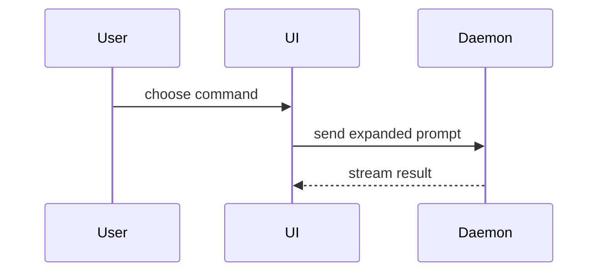

## Pick the template

The repository's own pull-request template comes first: fill _its_ sections in
_its_ order, and do not invent a parallel structure.

That is **one** file, in one of three places — any casing, `.md` or `.txt`:

```
.github/pull_request_template.md    # .github/ wins when several exist
pull_request_template.md            # repository root
docs/pull_request_template.md       # docs/
```

A `<dir>/PULL_REQUEST_TEMPLATE/*.md` folder instead holds several named
templates, and the author picks one with `?template=`. GitHub fills the body from
the **default branch**, which can lag the base branch; when the two copies differ,
say which file you followed. If more than one template file exists, use the one
GitHub would and name it.

Only when the repo has none, use the fallback template below.

The three ideas this skill adds map onto whichever template applies:

| Idea                 | Repo template, usually                                  | Fallback template |
| -------------------- | ------------------------------------------------------- | ----------------- |
| Summary + one visual | `## Summary`                                            | `## Summary`      |
| Evidence             | `## Before / After`, `## Testing` / `### Test Evidence` | `## Evidence`     |
| Merge Danger         | `## Risk and Rollback`                                  | `## Merge Danger` |

Fill every section of the repo template. Leave its checkboxes unticked unless the
statement is true, and name what is still missing rather than claiming it passed.
When a section does not apply, write the template's own opt-out ("N/A", "No
direct user impact", "Not applicable (explain why)") instead of deleting it.

### Fallback template

```markdown
## Summary

<diagram, diff-sketch, or tree>

## Evidence

- **Before:** <screenshot/output/failing test run>
  **After:** <screenshot/output/passing test run>

## Merge Danger

**Door:** <one-way or two-way>

<optional: description>

**Blast Radius:** <one-word description>

<optional: potential ramifications of merge>
```

## Sections

Skip all preambles and keep prose brief. Use the user's domain language from `CONTEXT.md`.

### Summary

Pick the smallest view that makes the key point clear, and put it in the template's summary section next to the text it supports.

- Show logic or an algorithm as pseudocode:

```text
on(save)
  if content is unchanged
    return cached result
  write new content
  return fresh result
```

- Show runtime control flow as a call tree:

```text
submitForm
  createSession
    persistPrompt
    launchAgent
  navigateToSession
```

- Show UI structure as a component tree, including state and module boundaries that matter:

```text
<SessionPage> (apps/example/src/routes/session.tsx)
  useSessionEvents()
  <SessionToolbar>
    <RunSkillButton> (packages/ui)
```

- Show file responsibility or a broad refactor as a shallow file tree:

```text
src/
├── commands/       # parses user actions
├── sessions/       # owns session state
└── transport/      # sends API requests
```

- Show component interaction, control flow, or data flow with Mermaid:



- Use `diff` when the point is what changes and the surrounding shape already exists. Match the diff shape to the topic.

For a component change:

```diff
 <SessionPage>
   useSessionEvents()
   <SessionToolbar>
+    <RunSkillButton />
   <SessionTimeline>
+    <SkillResultCard />
```

For a file-layout change:

```diff
 src/
 ├── commands/
+│   └── show-me.ts       # expands the slash command
 ├── sessions/
-└── transport.ts
+└── transport/
+    ├── client.ts
+    └── stream.ts
```

For a call-tree or call-stack change:

```diff
 submitForm
   createSession
     persistPrompt
+    expandSkillMention
     launchAgent
-  navigateToSession
+  navigateToSession
+    subscribeToEvents
```

For a state or control-flow change:

```diff
 on(save)
-  write content
+  if content is unchanged
+    return cached result
+  write new content
+  invalidate cache
```

- Show the whole block when most of it is new, when omitted context would hide ownership or order, or when the user needs a copyable target shape:

```ts
function expandSkill(command: string): string {
  const skillName = command.slice(1);
  return `use the ${skillName} skill`;
}
```

#### Guidance

Place each visual next to the short text it supports. Keep only the calls, files, props, states, and boundaries needed to answer the user's current question or the options to resolve the current discussion point.

You may use one of these, you may use several, it is unlikely you will use all of them. Use your judgement and don't overwhelm the user.

### Evidence

Concrete evidence that the change works. Show a before and after.

**Screenshots.** When the change is visual, look for captures from
`/test-drive-and-fix` in `<repo>/.agent/test-evidence/<branch>/`, paired
`<NN>-<slug>-before.png` / `<NN>-<slug>-after.png`. If pairs exist, load the
`pr-screenshots` skill and render its `Case | Before | After` table in the
template's before/after section — `## Before / After` in the usual repo
template, `## Evidence` under the fallback. Do not capture them yourself — a
capture is a deliberate `/pr-screenshots` run. The rest of the execution
evidence belongs in the template's testing section.

If the change is visual but no captures exist, write one line in place of a
table:

    No screenshots: <short reason>.

If the change is not visual:

    No screenshots: not a visual change.

**Execution evidence is A-tier.** Test results, console output. Show the exact
test that now fails and passes, using pseudocode.

Nothing is posted to GitHub without explicit approval for that action — see the
`pr-screenshots` skill.

### Merge Danger

Describe whether it's a one-way or two-way door. You can walk back through two-way doors, but not one-way doors. A PR that is cheap to roll back is lower risk. Changes that involve destructive actions or hard-to-reverse decisions are one-way doors.

The blast radius is the potential impact or scope of the changes introduced by this PR. Consider all possibilities. Examples are layout shift, breakages for consumers, mobile responsiveness, etc.

In a repo template this is usually `## Risk and Rollback`: set its risk level, keep its
rollback plan, and write the door and the blast radius into the prose rather than
adding a second heading.
